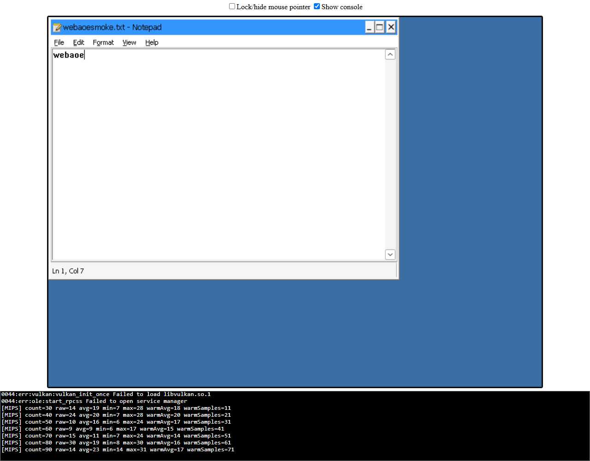

# 7. Compilación propia, aplicación Windows y primer intento con AoE II

Fecha: **2026-10-28 UTC**. Esta nota actualiza el estado histórico de los documentos anteriores.

## Resultado principal

**Se compiló el intérprete de Boxedwine y se ejecutó Notepad de Wine 11 dentro de Chrome en el Q6600.** Una prueba automatizada escribió texto mediante eventos de teclado, guardó desde el diálogo de Notepad y recuperó los mismos bytes del almacenamiento del navegador tras recargar la página.

**No se llegó todavía al menú de The Conquerors.** Se intentó arrancar la instalación local en dos filesystems, pero no se observó el menú durante las ventanas de prueba. No se ha determinado la causa.

## Build local completado

- Upstream: `8790ff20428c22daa64368af9553417e4f499c94`, sin modificaciones en archivos versionados.
- Target: `release` (intérprete de un hilo), `-O2`.
- Emscripten: **5.0.7**, revisión emcc `263db4cffa6f9fc2ec514a70abac81362ea41849`.
- Clang: **23.0.0git**, revisión `7b58716d96c3ae4c0c4e6f72e29b16137bb6224b`.
- Make: MSYS **4.4.1**, Git Bash en Windows.
- Python del SDK: 3.13.3; Node del SDK: 24.19.0. Las herramientas de prueba del repositorio usan Node del host 24.21.0.
- Dos trabajos paralelos; `SOURCE_DATE_EPOCH=1793199625` (fecha del commit).
- Compilación de 253 objetos y enlace completados. Se observó la salida normal de Make y los artefactos finales; no se conservó un código de salida separado del primer driver, que se había iniciado con un timeout del harness y siguió en segundo plano.
- No se compiló el JIT: activa SIMD y este Chrome/CPU no lo admite.
- Script reproducible: [`scripts/build-boxedwine.sh`](../../scripts/build-boxedwine.sh).
- Artefactos y logs quedan en `D:/webaoe-work/`, no en Git.

| Artefacto | Bytes | SHA-256 |
| --- | ---: | --- |
| `boxedwine.html` | 2603 | `300caa81e6007a180f540b6e0ce905e95c22d45b0c060853fd2765768cc22d7b` |
| `boxedwine.js` | 298592 | `ad43b4f2075b65f2d429a6f11bc2cd7d282f2364f9e365dc2ad1f811ac473806` |
| `boxedwine.wasm` | 3058049 | `01529262592f7db19d4836450fa7f9cc6c972378f27518a20b09c290abc2bc3b` |

Estos hashes identifican este build; no son firmas upstream ni demuestran reproducibilidad bit a bit en otro entorno.

## Navegador y capacidades observadas

Chrome **156.0.8078.73**, ejecutado headless mediante Playwright Core contra el Chrome ya instalado. Perfil temporal aislado; no se accedió al perfil habitual del usuario ni se desactivó la seguridad web.

- `crossOriginIsolated`: **true**.
- `SharedArrayBuffer`: disponible.
- Wasm SIMD: **false**, usando un módulo mínimo con `v128.const`.
- `WebAssembly.Suspending`: disponible.
- El WASM del intérprete local cargó y ejecutó Wine en este entorno sin el error SIMD.

Esto no certifica que cualquier build `release` futuro sea compatible ni que el juego tenga rendimiento suficiente.

## Prueba de Notepad con el build local y Wine 11

Ejecución aprobada: `2026-10-28T21:12:45Z` a `21:14:21Z`.

URL del laboratorio:

```text
http://127.0.0.1:8090/boxedwine.html?root=wine11&p=notepad.exe&sound=false&storageKey=local-wine11
```

Pasos observados:

1. Notepad apareció en el framebuffer del invitado.
2. La automatización hizo clic en el canvas de entrada y escribió `webaoe`.
3. Se abrió Guardar como y se guardó `webaoesmoke.txt` en el directorio inicial de Wine.
4. Se comprobó el archivo en el overlay invitado: `/root/key/local-wine11/home/username/webaoesmoke.txt`.
5. Contenido exacto: bytes `[119, 101, 98, 97, 111, 101]` (`webaoe`).
6. Se esperó explícitamente el callback de `FS.syncfs(false, ...)`.
7. Se recargó la página y el archivo reapareció con los mismos bytes.



**Límites:** persistencia validada tras recarga en el mismo contexto de navegador; no después de cerrar todo Chrome, limpiar datos o cambiar de origen. El flush fue explícito desde la prueba: no se ha certificado que cerrar una pestaña arbitrariamente siempre sincronice. Audio desactivado; red del invitado desactivada. No es una prueba de DirectDraw ni DirectPlay.

Los logs de Wine contienen advertencias sobre `wineboot.exe`, apiset, Vulkan y rpcss en estos filesystems reducidos. No impidieron esta prueba de Notepad, pero no se consideran corregidos ni irrelevantes para otros programas.

### Pruebas de referencia y ajustes del arnés

- El runtime precompilado oficial 26R1 con su Wine 6 también abrió Notepad y pasó guardado/recarga.
- El mismo runtime antiguo con el filesystem Wine 11 mostró solo el escritorio azul durante 75 segundos. Esto no demuestra que Wine 11 esté roto: con el build actual sí abrió Notepad.
- Dos intentos iniciales de interacción fallaron por sincronización/entrada: textos incompletos y puntuación del nombre de ruta; se usó finalmente un nombre relativo y tiempos de entrada más conservadores.
- El primer intento de interacción sobre el build actual falló porque el selector genérico `canvas` coincidía con dos capas. El arnés ahora apunta a `#canvas`, la capa de entrada; la capa WebGL tiene `pointer-events: none`.
- Los fallos se conservaron en `artifacts/`, no se reinterpretaron como aprobados.

## Primeros intentos con The Conquerors

Se encontró una instalación en `D:/AOE2/Age of Empires II - The Age of Kings`. Solo se leyó y se creó una copia empaquetada local para el invitado. **No se modificó ni ejecutó nativamente la instalación original.** Su procedencia y funcionamiento nativo aún no están confirmados por el usuario.

Inventario mínimo del ejecutable probado:

- Ruta relativa: `age2_x1/age2_x1.exe`.
- Tamaño: **2695213 bytes**.
- FileVersion: `00.07.22.0627`; ProductVersion: `2.1`.
- SHA-256: `f6c331dd78f5f8a63fbc08f49963733623482c4bd017bfc6426c6971d139a5d1`.
- Estos campos no bastan para asignarle con certeza un parche 1.0/1.0c/UserPatch ni verificar su autenticidad.

La copia privada contiene 1340 archivos, ZIP con DEFLATE nivel 1 de **431792325 bytes**. Está en `D:/webaoe-work/game-test/aoe2.zip`, fuera de Git y separada del servidor de Notepad. Se sirvió solo en `127.0.0.1`, sin subida a Internet; los originales permanecen intactos.

Configuración común:

```text
app=aoe2
p=age2_x1/age2_x1.exe
w=c:/files
args=nostartup
sound=false
storage=memory
```

El runtime montó la aplicación en `C:/files`, ejecutó Wine con el programa solicitado y mantuvo desactivada su red. La ausencia de recursos en Git no significa que el ZIP sea redistribuible; es exclusivamente un artefacto privado de prueba.

| Filesystem | Ventana de observación tras cargar página | Resultado |
| --- | --- | --- |
| Wine 11 reducido de la release web | 100 s | Escritorio azul; no se observó menú |
| Wine 6 reducido de la release web | 150 s | Escritorio azul; no se observó menú |

No hubo errores JavaScript ni peticiones de assets fallidas en los reportes; sí advertencias internas Wine, incluidas de RichEdit y componentes ausentes. La finalización del arnés (`completed=true`) **no significa que el juego arrancó**. No hay todavía una prueba de IA, campaña, audio, guardado ni multijugador del juego.

Un tercer intento de 60 s activó `WINEDEBUG=+process,+loaddll,+seh`. El trazado confirmó carga del ejecutable real, `DPLAYX.dll` y `DDRAW.dll` builtin, y posteriormente `EBUEulaX.dll`, `language_x1.dll` y RichEdit. La presencia de esas DLL **no prueba funcionamiento de DirectPlay o DirectDraw**. La última actividad es compatible con una ruta de presentación de EULA, pero no se observó un diálogo ni se confirmó que sea la causa del bloqueo. No se aceptaron términos de licencia en nombre del usuario ni se cambió su estado en el registro.

El primer intento de activar ese trazado codificaba el separador de `env` como `%3A` y falló antes de ejecutar Wine: `getEnvProp` upstream hace `split(':')` sin decodificar el valor, provocando un TypeError. Se repitió con `env=%22WINEDEBUG:+process,+loaddll,+seh%22` (separador, signos `+` y comas literales) y se obtuvo el trazado. No se modificó upstream; no confundir este fallo del parámetro con el arranque normal, que no lo utiliza.

Hipótesis pendientes, no diagnósticos confirmados: dependencias ausentes en los filesystems reducidos, configuración/registro/primera ejecución, comportamiento del ejecutable concreto, inicialización gráfica o temporización. No se atribuye el resultado a DRM sin evidencia. No se han modificado binarios ni incorporado parches de procedencia desconocida.

## Herramientas añadidas al proyecto

- `scripts/prepare-filesystems.py`: comprueba el ZIP oficial y extrae únicamente las dos imágenes Wine conocidas; verifica los hashes internos.
- `scripts/build-boxedwine.sh`: compila el checkout fijado, con dos trabajos y comandos Python explícitos para Git Bash.
- `scripts/serve-boxedwine.mjs`: valida revision/artefactos/hash de Wine y sirve el build local por loopback. No sirve la instalación del juego ni la carpeta privada `game-test`.
- `scripts/smoke-browser.mjs`: registra capacidades, consola, muestras y captura; no declara que una aplicación esté funcionando solo por cargar la página.
- `scripts/smoke-notepad.mjs`: prueba entrada, guardado desde UI, flush y restauración de bytes tras recarga. No escribe directamente el contenido esperado en el filesystem invitado.
- `package.json` y lockfile: Playwright Core **1.64.1**. Se usa Chrome instalado, sin descargar otro navegador.
- `.gitignore`: tool outputs, archivos del juego/ZIP/binarios y resultados locales fuera de Git.

Se verificó también el launcher local: HTTP 200, COOP/COEP correctos, MIME `application/wasm` y salida WASM no vacía. Pasaron comprobaciones sintácticas de scripts, `git diff --check`, enlaces Markdown locales y extracción verificada del paquete oficial. `npm test` aprobó **4 pruebas locales de validación de CLI** (URL obligatoria, rechazo de destinos remotos/hostname engañoso y puertos inválidos), sin requerir compilar el motor. Estas pruebas son adicionales a las 87 pruebas upstream de la investigación inicial.

## Cómo repetir la prueba básica

Desde el repositorio, en este equipo ya preparado:

```sh
npm ci --ignore-scripts
python scripts/prepare-filesystems.py
npm run dev
```

Abrir el URL que imprime el servidor. Detener con Ctrl+C. Desde otra terminal:

```sh
npm run smoke:notepad -- --url "http://127.0.0.1:8090/boxedwine.html?root=wine11&p=notepad.exe&sound=false&storageKey=smoke-wine11" --output artifacts/notepad-repeat
```

El launcher exige el checkout/artefactos externos. No instala el SDK automáticamente ni contiene el motor o los recursos del juego en el repositorio. Puede cambiarse la ubicación con `--work` para el launcher o `WEBAOE_WORK`/`WEBAOE_TOOLS` en Git Bash para el build.

## Próxima investigación

1. Confirmar con el usuario que ese ejecutable funciona nativamente y qué edición/parche instaló.
2. Ampliar el trazado de carga/procesos ya obtenido y comprobar la presentación/posición de posibles diálogos de primera ejecución, antes de cambiar componentes a ciegas.
3. Comparar configuración de registro/working directory y dependencias con una instalación Wine más completa si el trazado lo justifica.
4. Alcanzar menú y escaramuza antes de diseñar el lobby o integrar DirectPlay.

No hay servidores de prueba dejados intencionalmente abiertos al terminar estas ejecuciones.
